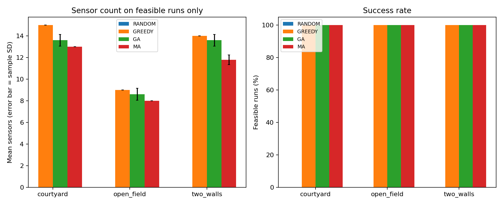
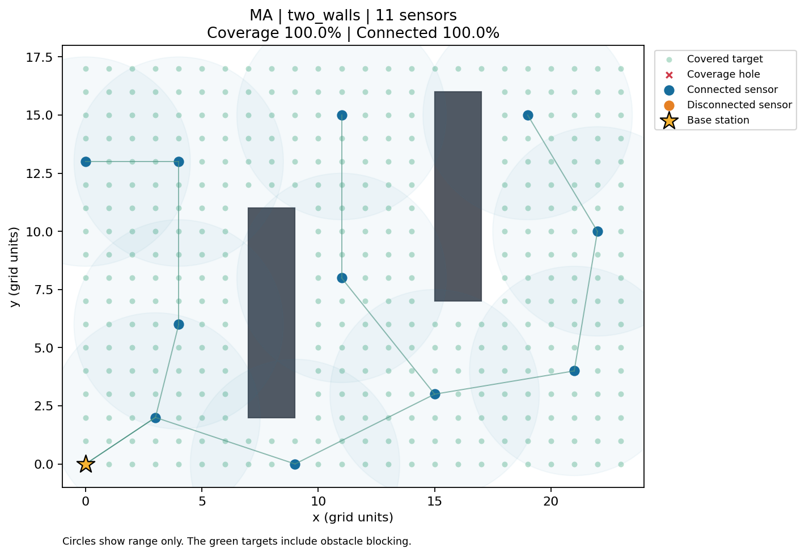
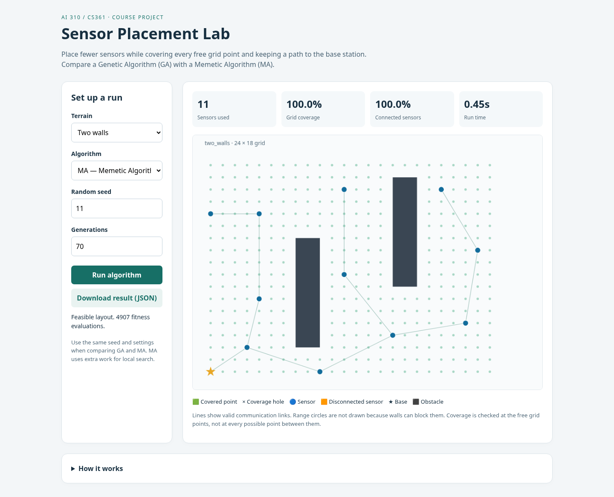

# Wireless Sensor Network Placement: GA and MA

**AI 310 / CS361 — Artificial Intelligence — Fall 2026**

This Python project places sensors on a 2D grid with obstacles. It tries to use fewer sensors while meeting two rules:

1. Every free grid point is sensed by at least one sensor.
2. Every sensor has a communication path to the base station.

We compare a **Genetic Algorithm (GA)** with a **Memetic Algorithm (MA)**. MA adds a small local search to move sensors towards coverage holes or the connected network.

**Scope:** 100% coverage means every free **integer grid point**. It does not prove coverage of all the space between points. The algorithms find good layouts; they do not prove the smallest possible sensor count.

## Quick start

Use Python **3.12 or newer**. Run these commands from this repository's root:

```bash
python -m venv .venv
source .venv/bin/activate
python -m pip install -r requirements-lock.txt
python -m wsn serve
```

On Windows, use `.venv\Scripts\activate` instead of `source .venv/bin/activate`. The demo listens on port 8000 on your own machine. It needs no API key, database, paid service, or sensor hardware. Stop it with Ctrl+C.

The browser screen lets you choose a terrain, GA or MA, a seed, and a generation count. It shows sensors, walls, valid links, coverage holes, and the base. You can download the result as JSON.

## Run without the browser

```bash
python -m wsn solve --terrain data/two_walls.json --algorithm ma --seed 42 --generations 70 --output results/local/ma.json --plot results/local/ma.png
python -m wsn solve --terrain data/two_walls.json --algorithm ga --seed 42 --generations 70 --output results/local/ga.json
python -m wsn verify results/local/ma.json
python -m unittest discover -s tests -v
python scripts/check_results.py
```

For an equal-work comparison, give both algorithms `--evaluation-budget 3000 --generations 10000`. Cached repeats do not spend another fitness evaluation. `--max-sensors` must be large enough for the shared starting layout; the default is 70.

## Measured results

Five seeds were used on each terrain. All GA and MA runs in this table reached full grid coverage and connectivity.

| Terrain | Greedy sensors | GA mean sensors | MA mean sensors |
|---|---:|---:|---:|
| Open field | 9 | 8.60 | 8.00 |
| Two walls | 14 | 13.60 | 11.80 |
| Courtyard | 15 | 13.60 | 13.00 |

These runs used the same population and generation count. MA used more fitness evaluations. With exactly **3,000 evaluations each** on Two walls, GA averaged **13.00** sensors and MA averaged **12.40**. Five runs are a small sample; these results do not prove MA is always better. Turning off MA's local search reproduced GA's results.





All 75 run files, settings, coordinates, raw CSV files, and plots are in [results/reference](results/reference/RESULTS.md). Every layout was checked again by a slower verifier using its coordinates.

Reproduce the experiments in a **new** directory:

```bash
python scripts/experiments.py --output results/local/repeated
```

The script refuses to overwrite an existing result set. The data are three included synthetic maps, not a real-world public benchmark. See the [dataset card](data/README.md).

For optional PDF/Word rebuild and real-browser test commands, see [Testing](docs/TESTING.md). These extra tools are not required to run GA or MA.

## Documentation

- [PDF report](docs/Project_Report.pdf) and [editable Word report](docs/Project_Report.docx): report, assessment, team roles, and discussion guide in one file.
- [Full project report](docs/REPORT.md): idea, features, six-paper review, model, algorithms, measured results, and platform.
- [Assessment checklist](docs/ASSESSMENT.md): evidence for each course criterion; no made-up teacher grades.
- [Six team roles](docs/TEAM.md): blank names and IDs, shared tasks, and actual contribution log.
- [Requirements checklist](docs/REQUIREMENTS.md): every requested item and its evidence.
- [Design diagrams](docs/DESIGN.md): use cases, data flow, class structure, and algorithm flows.
- [Discussion guide](docs/DISCUSSION.md): simple answers and a short demonstration plan.
- [Source metadata](docs/sources/README.md): checked academic reference details and review limits.
- [Testing and limitations](docs/TESTING.md): test commands, outcomes, and known limits.
- [AI assistance and integrity](docs/ACADEMIC_INTEGRITY.md): honest use and team preparation.

## Files

```text
wsn/                 terrain, algorithms, verifier, CLI, plots, and web server
web/                 simple browser screen
data/                three repeatable terrain files
tests/               geometry, network, algorithm, and HTTP tests
scripts/             experiment and document tools
docs/                report, assessment, roles, and diagrams
results/reference/   measured experiment evidence
.github/workflows/   automatic test configuration
```

Run from the checkout root. The optional `pip install -e .` command installs the `wsn` CLI; the web screen and default data paths still use the checkout. This is a local teaching demo, not a public production web server.

The six member names and student IDs are left blank as requested. All role assignments are proposed. The team must record what each person actually does, understand the work, and check the course's rules for AI assistance before submission.


