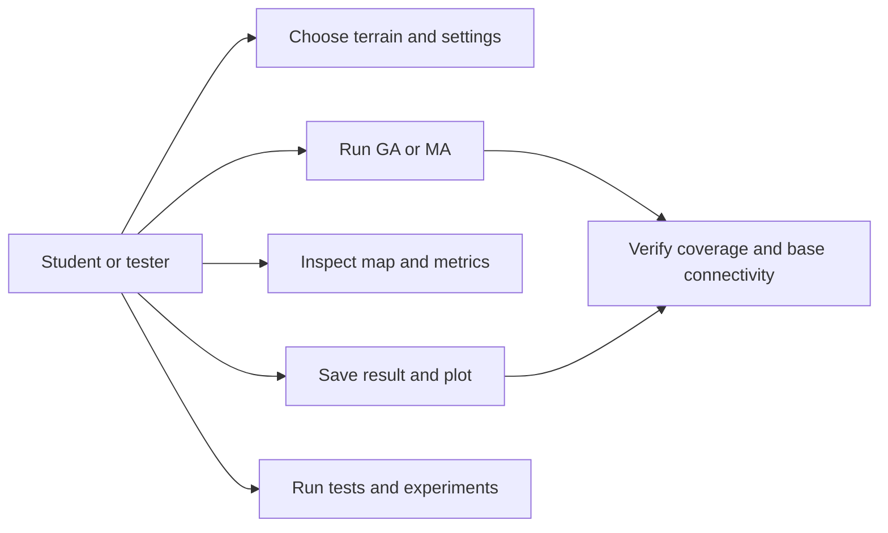
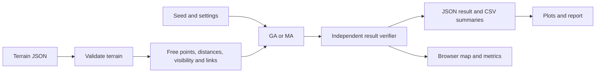
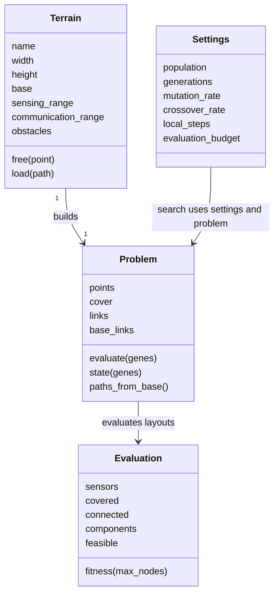
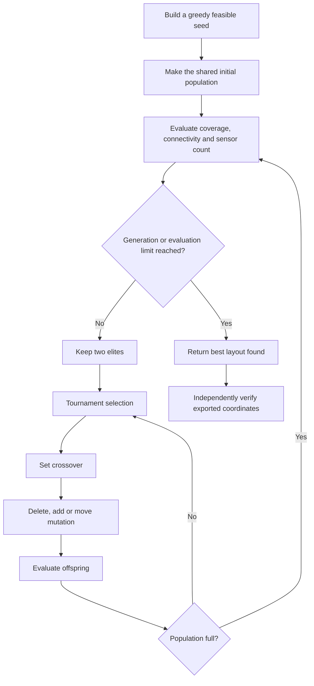
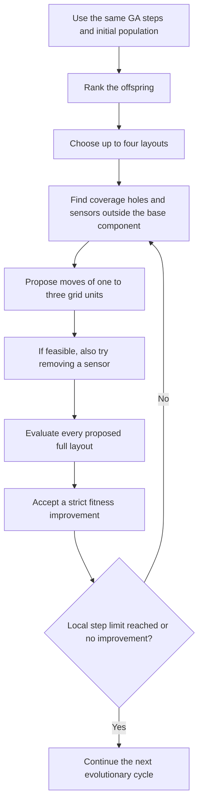
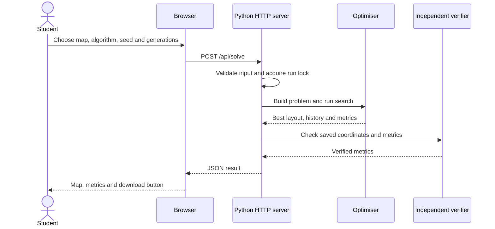

# Analysis and design

The user supplies a map and search settings. The program checks the terrain, prepares distances and visibility, runs the chosen algorithm, verifies the answer, and shows or saves it. There is no database and no external API in the running application.

## Use cases

## Data flow

The optimiser uses precomputed matrices. The independent verifier rebuilds the checks from exported coordinates with scalar distances and line-of-sight checks. It does not reuse those matrices.

## Main data classes and functions

`optimise` is a function, not a class. It uses `Problem` and `Settings`, and returns a JSON-compatible dictionary. GA and MA share this function. The `algorithm` option turns the local phase on or off.

## GA flow

## MA flow

Local search does not teleport a sensor across the map. It moves towards a target by a small distance, rounds to a legal integer point, and rejects blocked or duplicate locations. It checks the whole layout because fixing one hole can create another hole or break a link.

## Browser request sequence

Only one search runs at a time in the demo server. An overlapping request gets a clear busy message. The HTTP server serves the demo page and two API routes; it does not expose arbitrary repository files.

## Exported result

| Field | Meaning |
|---|---|
| `algorithm`, `seed`, `settings` | How the run was made |
| `terrain` | Full map and range values |
| `coordinates`, `location_ids` | Chosen active sensor positions |
| `metrics` | Coverage, connectivity, components, count, feasibility |
| `history` | Best score and metrics after each recorded cycle |
| `evaluations` | Unique search fitness evaluations; cache repeats excluded |
| `runtime_seconds` | Search timing; shared geometry setup is outside it |
| `stop_reason` | Generation limit or evaluation budget |

The static SVG diagrams in `figures/` are also used in the printable report. Mermaid diagrams above remain editable in GitHub.
