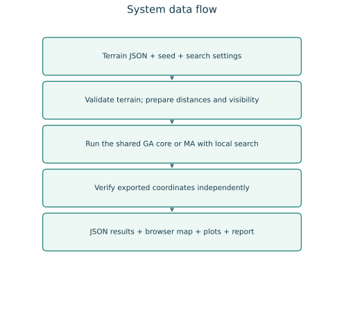
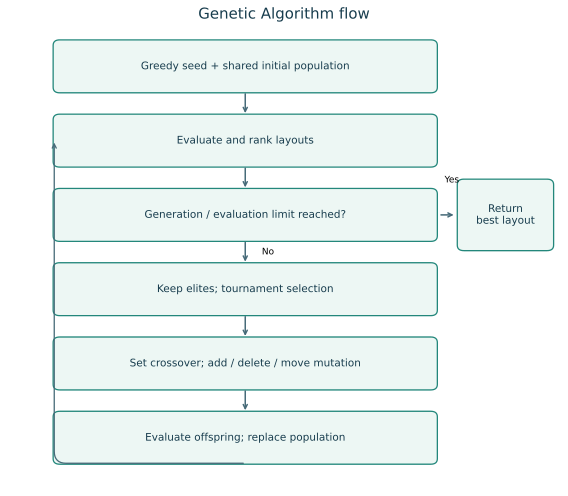
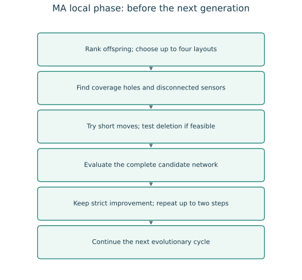
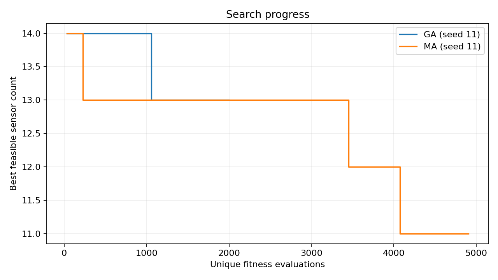

# Wireless Sensor Network Deployment Optimisation Using GA and MA

**AI 310 / CS361 — Artificial Intelligence — Fall 2026**

Group number: ____________________  
Programme: ____________________  
Teaching assistant: ____________________  
Submission date: ____________________

| Member | Name | Student ID | Proposed main responsibility |
|---|---|---|---|
| 1 | ____________________ | ____________________ | Model and terrain data |
| 2 | ____________________ | ____________________ | Genetic Algorithm |
| 3 | ____________________ | ____________________ | Memetic Algorithm |
| 4 | ____________________ | ____________________ | Tests and experiments |
| 5 | ____________________ | ____________________ | Literature and report |
| 6 | ____________________ | ____________________ | Demo and diagrams |

These are proposed roles. The names and IDs are blank as requested. The team must add its actual contributions in `TEAM.md`. This package was built with substantial AI assistance; see the disclosure in section 12.

## Abstract

Wireless sensors can monitor places such as farms, forests, and building boundaries. Using too many sensors costs more money and energy. Using too few may leave unseen points or break the route to the base station. This project models the problem on a 2D grid. Rectangular obstacles block both sensing and communication. We implement a Genetic Algorithm (GA) and a Memetic Algorithm (MA). Both search for layouts with fewer sensors while keeping full grid coverage and base connectivity. MA adds short local sensor moves and checks whether redundant sensors can be removed. We test three synthetic maps with five random seeds, compare two baselines, and run an equal-evaluation check. All main GA and MA runs are feasible. MA uses fewer sensors on average in these tests, but it also does extra work per generation. We do not claim a global minimum or continuous-area coverage.

## 1. Project idea

A wireless sensor measures something near its position. It may collect temperature, movement, or pollution data. Its sensing range is limited. It also needs to send its data to a base station. A sensor can send data directly to the base or through other sensors.

An obstacle, such as a wall, may block the straight signal between two positions. Even a sensor close to the base can be disconnected if a wall is between them. A useful deployment must solve the coverage and communication problems together.

Our goal is to choose the number and positions of sensors. We want to use a small number of active sensors while meeting both conditions:

1. Every free target point is covered by at least one sensor.
2. Every active sensor has a path to the base through valid communication links.

The project uses a finite grid. Every free integer grid point is a target and a possible sensor location. This is a clear simulation model, not a proof that every point in a continuous physical area is covered.

## 2. Objectives and scope

The main objectives are to model obstacles correctly, implement both algorithms, compare them using repeatable experiments, and explain the results in simple terms.

The simulation has one fixed base, equal sensor ranges, static obstacles, and no hardware. The base does not sense. Separate sensing hardware may be placed at the base coordinate and counts as a sensor. We use straight-line sensing and communication. A segment that touches an obstacle boundary is blocked.

We do not model battery life, interference, packet loss, different sensor types, movement, height, weather, or radio signal strength. These are possible extensions, not completed features.

## 3. Main functions

| Function | What the program does |
|---|---|
| Load a map | Read grid size, obstacles, base, and signal ranges from JSON |
| Validate the terrain | Reject invalid sizes, blocked bases, and invalid ranges or rectangles |
| Check visibility | Test line segments against each closed obstacle rectangle |
| Measure coverage | Count all free targets sensed by at least one active sensor |
| Check connectivity | Find sensors reachable from the base using valid links |
| Run GA | Select, combine, and change candidate sensor layouts |
| Run MA | Add a local phase to repair layouts and reduce sensor count |
| Show a demo | Display the map, sensors, valid links, and result metrics |
| Save evidence | Export coordinates, settings, history, CSV summaries, and plots |
| Verify results | Recheck exported coordinates with a slower independent calculation |

The browser demo is simple. It lets the user choose one of three maps, choose GA or MA, and set a random seed and generation count. A command-line version supports saved plots and an optional evaluation budget.

## 4. Similar applications and tools

These are related tools used for simulation or deployment planning. They are not claims that a commercial product solves this exact assignment with GA and MA.

| Tool | Related purpose | Difference from this project |
|---|---|---|
| [MATLAB and Global Optimization Toolbox](https://www.mathworks.com/products/global-optimization.html) | Numerical modelling, plots, and genetic optimisation | General tools; a user must build the sensor coverage and connectivity model |
| [ns-3](https://www.nsnam.org/) | Network simulation, protocols, and communication studies | Focuses on network behaviour; our project focuses on choosing sensor locations |
| [Cooja / Contiki-NG](https://docs.contiki-ng.org/en/develop/doc/cooja/Running-Contiki-NG-in-Cooja.html) | Simulation of small connected devices and their software | Useful for network behaviour after deployment; our model simplifies the radio and studies placement |

Our project is smaller and easier to explain. It shows the effect of obstacles, genetic search, and local repair in one place. It does not replace a detailed network simulator or a professional site survey.

## 5. Literature review: six academic papers

The references below are real academic publications. Titles, authors, venues, pages, and DOI identifiers were checked using Crossref metadata. The summaries are short and written in our own words. Metadata checking is different from reading every full paper; source access and review limits are recorded in `sources/README.md`.

### Paper 1 — Coverage problems in wireless ad-hoc sensor networks

**S. Meguerdichian, F. Koushanfar, M. Potkonjak, and M. B. Srivastava, 2001.** IEEE INFOCOM, volume 3, pages 1380–1387. DOI: [10.1109/INFCOM.2001.916633](https://doi.org/10.1109/INFCOM.2001.916633).

This paper studies geometric coverage problems in sensor networks. It shows why coverage needs a clear mathematical definition rather than a visual guess from a map. Its geometric approach is useful background for checking how positions affect monitoring quality.

**Link to our project:** We define exactly which grid points must be covered and check them all. We do not implement the paper's full geometric coverage methods, and we do not use its theory as proof of coverage between grid points.

### Paper 2 — The Coverage Problem in a Wireless Sensor Network

**Chi-Fu Huang and Yu-Chee Tseng, 2005.** Mobile Networks and Applications, 10(4), pages 519–528. DOI: [10.1007/s11036-005-1564-y](https://doi.org/10.1007/s11036-005-1564-y).

This paper studies whether a region is sufficiently covered by sensors. It discusses coverage levels, including coverage by more than one sensor. It gives useful background for distinguishing a coverage test from a placement algorithm.

**Link to our project:** We require one covering sensor per free target, often called 1-coverage. We use direct finite-grid checking and do not claim to implement the paper's continuous-region coverage test. Requiring two covering sensors would be a future fault-tolerance extension.

### Paper 3 — Deploying wireless sensors to achieve both coverage and connectivity

**Xiaole Bai, Santosh Kumar, Dong Xuan, Ziqiu Yun, and Ten H. Lai, 2006.** ACM MobiHoc, pages 131–142. DOI: [10.1145/1132905.1132921](https://doi.org/10.1145/1132905.1132921).

This paper studies deployment with both coverage and connectivity goals. It is relevant because a network can cover an area while still having sensors that cannot send their data to the rest of the network. Deployment design depends on both sensing and communication ranges.

**Link to our project:** We evaluate the two requirements separately and only accept full success when both hold. Our rectangular obstacles can break straight links, so we use explicit base reachability instead of assuming coverage guarantees connectivity.

### Paper 4 — Sensor placement for effective coverage and surveillance in distributed sensor networks

**S. S. Dhillon and K. Chakrabarty, 2003.** IEEE WCNC, volume 3, pages 1609–1614. DOI: [10.1109/WCNC.2003.1200627](https://doi.org/10.1109/WCNC.2003.1200627).

This paper treats sensor placement as a way to improve coverage and surveillance. It is useful background for thinking about placement choices and coverage quality instead of only increasing the sensor count.

**Link to our project:** Our objective also treats sensor positions as decisions. Our model uses a simple yes/no sensing range with obstacle blocking. We do not claim to reproduce the paper's sensing model, algorithms, or measurements.

### Paper 5 — A fast and elitist multiobjective genetic algorithm: NSGA-II

**K. Deb, A. Pratap, S. Agarwal, and T. Meyarivan, 2002.** IEEE Transactions on Evolutionary Computation, 6(2), pages 182–197. DOI: [10.1109/4235.996017](https://doi.org/10.1109/4235.996017).

NSGA-II is an evolutionary method for problems with several objectives. It uses ideas such as keeping strong solutions while keeping a useful spread of solutions. It helps explain why cost and quality can pull a search in different directions.

**Link to our project:** We balance coverage, connectivity, and sensor cost and keep elite layouts. Our implementation is a simpler feasibility-first GA. It is not NSGA-II, does not use nondominated sorting or crowding distance, and does not output a Pareto front.

### Paper 6 — Memetic algorithms and memetic computing optimization: A literature review

**Ferrante Neri and Carlos Cotta, 2012.** Swarm and Evolutionary Computation, volume 2, pages 1–14. DOI: [10.1016/j.swevo.2011.11.003](https://doi.org/10.1016/j.swevo.2011.11.003).

This review describes memetic optimisation, which combines a wider search with local improvement. The wider search explores different regions, while local search improves particular candidates. The local method and the time spent on it are important design choices.

**Link to our project:** GA provides the wider search. MA adds short movement proposals and removal tests. We measure the extra evaluation cost and include a run without local search to check the effect of this part.

### What we take from the review

Papers 1, 2, and 4 motivate clear coverage and placement models. Paper 3 motivates checking coverage and connectivity together. Paper 5 explains evolutionary search under competing goals. Paper 6 motivates a local phase and the need to account for its cost.

The contribution of this course project is an understandable implementation of the assigned combination: grid coverage, obstacles, base connectivity, GA, and local MA repair. It is not a claim of a new research algorithm or a full reproduction of those papers.

## 6. Dataset and terrain

We use three synthetic JSON maps created for this project. They are included in `data/`, with no hidden download or preprocessing step. A public dataset was preferred by the course, but not required. We do not label these maps as a real-world public benchmark.

| Map | Grid | Free target points | Obstacles | Purpose |
|---|---|---:|---:|---|
| Open field | 20 × 16 | 320 | 0 | Simple reference without blocked signals |
| Two walls | 24 × 18 | 372 | 2 | Wall edges, coverage holes, and routes around walls |
| Courtyard | 26 × 20 | 433 | 3 | Several blocked areas and a narrow opening |

All maps use a base at `(0, 0)`, sensing range 4.5, and communication range 7.0. One unit is the distance between neighbouring grid points. An obstacle is a closed rectangle `[left, bottom, right, top]`. Both its interior and boundary are blocked.

The dataset is small enough for repeated student experiments. It does not show how the algorithms would perform on all possible terrains or real radio networks.

## 7. Problem model and fitness

### 7.1 Distance and visibility

For points `a = (ax, ay)` and `b = (bx, by)`, Euclidean distance is:

`distance(a, b) = sqrt((ax - bx)^2 + (ay - by)^2)`.

A sensor covers a target if the distance is at most the sensing range and the line segment is not blocked by an obstacle. Two sensors can communicate if the distance is at most the communication range and their line segment is clear. The same rule is used for a sensor-to-base link.

The geometry uses segment–rectangle intersection, including tangents and corner touches. It checks the whole segment, not only its endpoints. Distances and visibility are precomputed once for the map.

### 7.2 Coverage

Let `T` be the free target points and `S` be the active sensors.

`coverage = number of targets covered by at least one sensor / number of targets`.

A target needs only one covering sensor. More overlap does not increase the covered target count. Obstacle points are not targets. The base does not provide sensing coverage unless a counted sensor is also placed at its coordinate.

### 7.3 Connectivity

Build an undirected graph with one node for each sensor and one node for the base. Add an edge only if range and visibility both allow communication. Starting from the base, follow these edges to find reachable sensors.

`connectivity = sensors reachable from the base / active sensors`.

For an empty layout, the connectivity ratio is defined as 1 by convention, but coverage is 0, so it is not feasible. This avoids division by zero without rewarding an empty layout as a full solution.

The reported component count includes the base component, even when it contains no sensors. Sensors outside this component are disconnected from the base.

### 7.4 Chromosome

A chromosome is a sorted set of IDs for active sensor positions. Each ID maps to a free integer `(x, y)` coordinate. The length of the chromosome is the active sensor count. Duplicate locations are rejected. Adding, deleting, or moving an ID changes the layout and, in some cases, its length.

This representation evolves sensor coordinates on the grid. There is no hidden fixed sensor count and no continuous-coordinate claim.

### 7.5 Fitness

Let `n` be the sensor count and `M` the allowed maximum count. A layout is feasible when every target is covered and every sensor is reachable from the base.

For a feasible layout:

`fitness = 11 - n / M`.

For an infeasible layout:

`fitness = 4 × coverage + 2 × connectivity - 0.1 × n / M`.

Every feasible layout scores at least 10, while an infeasible layout scores at most 6. This makes feasibility the first priority. Among feasible layouts, fewer sensors always wins. Before feasibility, the score encourages coverage and connectivity while applying a small count penalty.

The weights are a simple project choice, not a proven best setting. A different set of weights could change repair behaviour on other maps.

## 8. Algorithms and design

### 8.1 Shared starting population

First, a greedy set-cover procedure selects sensors that cover many uncovered targets. Only candidate locations connected to the base in the full candidate graph are used. Paths in that graph add any needed relay sensors. A removal pass deletes a sensor only when coverage and connectivity remain complete.

If all reachable candidates together cannot cover every target, no connected layout can cover the map under this model. The program reports that case rather than claiming success. If the feasible seed needs more than the chosen sensor limit, the user must raise that limit. The search does not treat a smaller limit as proven impossible.

The population includes the seed, mutations of it, and random layouts. GA and MA receive the same seed, random seed, initial population, operators, and settings. The seed is already feasible. Therefore, success in our standard runs does not prove either search can always discover feasibility from a fully random start.

### 8.2 Genetic Algorithm

Each generation keeps two elite layouts. Tournament selection chooses the best of three sampled candidates. Set crossover keeps the parents' common positions and randomly selects some positions that appear in just one parent. Mutation randomly tries one action: delete a sensor, add a sensor, or move a sensor to a nearby free point.

All offspring are evaluated on full coverage and connectivity. Better layouts are kept through the population and a best-so-far record. The algorithm stops at its generation limit or unique-evaluation budget.

### 8.3 Memetic Algorithm

MA uses the same GA core, then applies local search to up to four high-ranked offspring per generation. It makes at most two local steps per chosen layout.

For coverage holes, it selects a few uncovered targets and nearby sensors. It proposes sensor movements towards these targets. For disconnected sensors, it proposes movements towards a reachable sensor or the base. Each movement is one to three grid units in the target direction, rounded to an integer point. Blocked, out-of-bounds, or duplicate destinations are rejected.

For a feasible layout, MA also tests sensor removal. It accepts a proposal only when the full layout has strictly better fitness. It never assumes that moving closer automatically fixes the whole network. If no proposal improves fitness, local search stops for that layout.

This phase happens before the next evolutionary cycle. It directly addresses the project's requirement to repair holes or isolated parts with small coordinate changes.

### 8.4 Design diagrams and modules







The editable use cases, data flow, class diagram, algorithm flows, and browser sequence are in `DESIGN.md`. Main modules are `model.py`, `algorithms.py`, `verify.py`, `plotting.py`, `cli.py`, and `web.py`.

### 8.5 Main settings

| Setting | Main experiment value |
|---|---:|
| Population | 36 |
| Generations | 70 |
| Maximum sensors | 70 |
| Crossover probability | 0.90 |
| Mutation probability | 0.85 per offspring |
| Tournament size | 3 |
| Elite layouts | 2 |
| MA local layouts per generation | Up to 4 |
| MA local steps per layout | Up to 2 |
| Movement radius | Up to 3 grid units |
| Seeds | 11, 22, 33, 44, 55 |

The maximum sensor count limits the chromosome length. It is not a claim that the map needs 70 sensors. The final counts are much smaller.

## 9. Experiments and results

### 9.1 Method

The main comparison uses three maps, five seeds, and four methods: random placement, greedy placement, GA, and MA. This gives 60 stored run records. Greedy is deterministic; its five repeated records per map are the same layout, not independent searches. Random uses the same sensor count as that map's greedy layout and the same declared seeds.

We add ten equal-budget runs on Two walls, with exactly 3,000 unique fitness evaluations per GA or MA run. A high generation limit lets the budget stop the search. We also add five MA runs with local search disabled. In total there are 75 run records.

Each exported layout is checked by an independent scalar calculation of distances, obstacle intersections, coverage, and base reachability. Raw JSON runs, CSV tables, settings, plots, and summary files are stored in `results/reference/`.

### 9.2 Main comparison

All GA, MA, and greedy runs in the main comparison are feasible. The random layouts fail full coverage and/or full connectivity in all 15 random runs. Failed random layouts are retained in the raw files and their sensor counts are not presented as successful solutions.

| Map | Greedy sensors | GA mean ± sample SD | MA mean ± sample SD | GA success | MA success |
|---|---:|---:|---:|---:|---:|
| Open field | 9 | 8.60 ± 0.55 | 8.00 ± 0.00 | 5/5 | 5/5 |
| Two walls | 14 | 13.60 ± 0.55 | 11.80 ± 0.45 | 5/5 | 5/5 |
| Courtyard | 15 | 13.60 ± 0.55 | 13.00 ± 0.00 | 5/5 | 5/5 |


For Two walls, MA used about 13.2% fewer sensors than GA on average: `(13.60 - 11.80) / 13.60`. However, this is an equal-generation comparison, not equal work.

| Map | GA mean evaluations | MA mean evaluations | GA mean seconds | MA mean seconds |
|---|---:|---:|---:|---:|
| Open field | 2,015 | 4,531 | 0.195 | 0.391 |
| Two walls | 2,012 | 5,473 | 0.212 | 0.480 |
| Courtyard | 1,998 | 5,923 | 0.226 | 0.539 |

The timings describe this prepared machine and one run of the experiment script. They exclude shared geometry construction and the shared seed construction for GA/MA. They are not a general speed claim. Full setup and plotting time is different. Cache hits do not count as new evaluations.

### 9.3 Equal-evaluation comparison

| Map | Method | Evaluations per run | Mean sensors ± sample SD | Success |
|---|---|---:|---:|---:|
| Two walls | GA | 3,000 | 13.00 ± 0.71 | 5/5 |
| Two walls | MA | 3,000 | 12.40 ± 0.55 | 5/5 |

MA used about 4.6% fewer sensors on average in this check. For the paired seeds, MA tied GA twice and used one fewer sensor three times. This is useful evidence for this map and budget, but it is a small sample. We do not claim statistical significance or that MA always wins.

### 9.4 Local-search removal test

Turning off MA's local search produced the same final layouts and histories as GA for all five paired Two walls runs. Both averaged 13.60 sensors. This checks that the two methods share the same genetic core and that the changed behaviour comes from the local phase and its later effect on the search.

### 9.5 Example layout and search progress

The examples below use the first declared seed, 11. They were not selected after searching for the most impressive picture.




Green points are covered targets. Blue sensors are connected to the base. Grey walls block sensing and communication. Lines in the layout plot are valid communication links. Faint sensing circles show range only; the point colours are the actual obstacle-aware coverage evidence.

### 9.6 Interpretation and limits

The local phase helps MA improve the sensor count in these runs. The shared feasible seed and elitism keep a feasible layout available. This makes the project reliable for a classroom demonstration, but it also means the experiments do not test hard feasibility discovery from scratch.

The evidence covers only three small maps and five seeds. There is no test of real radio signals, mobile sensors, or large outdoor terrain. Equal-budget testing was done on one map. Weight tuning, many-map testing, continuous coverage verification, and larger statistical studies remain future work.

## 10. Development platform and repeatability

The validated environment uses Python 3.12.14 on Linux, NumPy 2.3.5, and Matplotlib 3.10.8. The locked transitive requirements include a package requiring Python 3.12, so the project requires Python 3.12 or newer. The HTTP server and automated tests use Python's standard library. There is no database, cloud key, paid API, or GPU requirement.

Create a virtual environment, install `requirements-lock.txt`, and run from the repository root. NumPy handles arrays and seeded random choices. Matplotlib writes figures without a desktop. A GitHub Actions workflow is configured for Python 3.12 and 3.13; a configuration file alone is not proof that those remote jobs passed.

Reproduction commands:

```bash
python -m venv .venv
source .venv/bin/activate
python -m pip install -r requirements-lock.txt
python -m unittest discover -s tests -v
python scripts/experiments.py --output results/local/repeated
python -m wsn serve
```

The experiment script refuses to overwrite existing evidence. Same seeds and pinned packages reproduce the coordinate results and search histories; exact elapsed times depend on the machine. Dense precomputed matrices use memory proportional to the square of the number of free points. This is suitable for the included small maps, not a scalable deployment engine.

## 11. Testing and assessment

The prepared environment passed 38 automated tests. These include exact range boundaries, blocked segments, corner touches, relay paths, disconnected groups, invalid inputs, same-seed repeatability, genetic operator validity, three local-search behaviours, a tiny exhaustive optimum check, budget limits, and HTTP requests.

The vectorised geometry is compared against scalar geometry for every pair in a small obstacle map. The saved-layout verifier checks exported coordinates without using cached search matrices. The tiny exact test is only a correctness example; it is not an optimality proof for our larger maps.

The command-line solve, plot export, independent verify command, browser home page, health request, and an actual HTTP MA solve were exercised. A real Chromium browser also ran both algorithms, checked displayed metrics, downloaded and verified both JSON results, and checked desktop, tablet, and phone widths. No JavaScript errors were found. This is a functional smoke test, not a full accessibility audit.

The assessment checklist in `ASSESSMENT.md` maps every supplied course criterion to code, experiments, or documents. No instructor marks or approval are invented.

## 12. Team roles, academic integrity, and submission

Member 1 leads the model and data. Member 2 leads GA. Member 3 leads MA. Member 4 leads testing and experiments. Member 5 leads the literature and report. Member 6 leads the demonstration and diagrams. All six members must contribute across requirements, research, design, review, validation, documentation, and discussion. Main roles do not excuse other phases.

These are proposed roles. `TEAM.md` contains blank names, student IDs, TA approval, and actual contribution records. The assistant cannot truthfully fill human contribution claims or register the group.

This implementation and report were produced with substantial help from an AI coding assistant. The course says students must submit their own work but does not give an AI-use rule here. The team must check what the TA allows and disclose the assistance. Before submission, each member must review the code and report, run the checks, read a paper, record their real work, and prepare to explain the whole project.

The course says submission and discussion occur in Week 12/13. No exact calendar deadline was supplied, so no date is invented. The team must complete registration, fill its details, confirm the deadline, and upload the required files through the course system.

## 13. Conclusion

The project implements a complete grid simulation with obstacle-aware sensing and communication, a GA, and an MA with local repair. It includes a working demo, repeatable experiments, checked results, and clear documentation. MA found smaller layouts on average in the tested cases. The results support this small simulation study, not a claim of a proven global minimum or guaranteed real-world performance.
